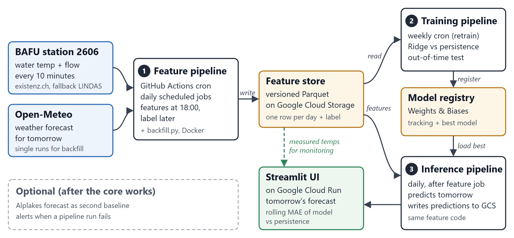

# Lake Geneva Temperature Forecast

The goal: predict tomorrow's mean water temperature of Lake Geneva at Geneva (BAFU station 2606, Rhône at Genève Halle de l'Île, where the lake drains). The forecast will be made every evening from the data measured before 18:00 and compared with persistence ("tomorrow = the temperature now"). What runs today: the feature pipeline every evening and the training pipeline every Monday. The live forecast comes in MS4.

Built as the MLOps HS26 semester project (HSLU) with the Feature / Training / Inference (FTI) pipeline architecture.



*Architecture from the proposal. Changed in MS2: the live water data comes from the BAFU Data Platform (existenz.ch only as fallback, no LINDAS); the features use the 48-hour-old forecast, the Single Runs only for a comparison.*

## Status
- [x] MS1 – Proposal (`docs/proposal.pdf` is the repository version of 02.10.2026; the reviews used the version submitted on ILIAS)
- [x] MS2 – Feature pipeline (summary and response to the MS1 reviews: `docs/ms2_summary.pdf`)
- [ ] MS3 – Training pipeline
- [ ] MS4 – Live system

## Goal and success criterion
Every evening on day D the model predicts the mean water temperature of D+1 from the data before the 18:00 cutoff. BAFU publishes its readings about 1.5 hours late, so the forecast is ready after the evening job, not at 18:00 itself: at 20:00 Swiss time in winter and 21:00 in summer at the earliest (3 to 28 hours ahead), and later when GitHub starts the job late (around midnight in late October 2026). This changes the "18:00" of the proposal. A forecast at 18:00 sharp would only have the readings until about 16:30, and persistence would be about 4 % worse (checked on 30.10.2026).

The model succeeds if its MAE is **at least 20 % lower than the MAE of the target baseline, on the same days**:
- **Main target:** the test days from 21.01.2025 on. For each test day the model is trained again on the earlier days whose label is already known at 18:00 of that day (walk-forward evaluation in MS3). The day just before is not used, because its label is the mean of the test day itself. The first year with all features (21.01.2024–20.01.2025, 366 days) is for validation: it is used to choose the model settings and the target baseline and never counts for the target. The same rule holds there: both use the validation days up to 19.01.2025, whose labels are known at 18:00 on the first test day.
- **Target on the big-change days:** the test days on which tomorrow's mean differs by more than 0.8 °C from today's last reading before 18:00. On these days persistence fails.
- **Reported, not a target:** October–January (177 test days on 14.11.2026; only 7 of them are big-change days, too few for a target) and the live period October 2026 – January 2027 (monitoring in MS4).

The **target baseline** is trend-adjusted persistence: the last reading before 18:00 plus a factor times the 3-day trend. The factor was chosen once, on the 365 validation days only, as the one with the lowest MAE, and then frozen in `baselines.py` (20.11.2026, MS2 review point B1). Before, the target used the better of plain and trend-adjusted persistence on the test days themselves, so it could switch as new test days came in.

| Validation days (21.01.2024–19.01.2025) | MAE |
|---|---|
| plain persistence (factor 0) | 0.506 °C |
| factor 1/3 (one day of the trend, suggested in the MS1 reviews) | 0.746 °C |
| **factor −0.075** (lowest MAE, frozen) | **0.495 °C** |

The factor is negative: tomorrow tends to move a little against the 3-day trend. Its gain over plain persistence on the validation days is small (95 % interval −0.0245 to −0.0001 °C), and it was fitted on those same days, so it is no proof that it is better on new days. It is a fixed choice: the target never switches back to plain persistence, also where persistence is better on the test days (all test days: 0.526 against 0.530 °C). Plain persistence stays in every table, for comparison.

| Test days (21.01.2025–12.11.2026, 18:00 cutoff) | Days | Persistence MAE | Target baseline MAE | Target MAE (−20 %) |
|---|---|---|---|---|
| all test days | 661 | 0.526 °C | 0.530 °C | ≤ 0.424 °C |
| change > 0.8 °C | 101 | 1.930 °C | 1.897 °C | ≤ 1.518 °C |
| October–January (reported) | 177 | 0.281 °C | 0.306 °C | (0.245 °C) |

Numbers of 14.11.2026. Every new day adds one test day, so the numbers move a little; the baseline and its factor do not (on 27.10.2026, in the MS2 summary, with the old rule: 643 test days and a target of 0.425 °C). `python src/lakegeneva/common/baselines.py` recomputes them with 95 % bootstrap intervals [8] (blocks of 7 calendar days) and fits the factor again as a check. The criterion changed since the proposal; `docs/ms2_summary.pdf` explains why (MS1 review points A1, A2/B2, B3).

## Related work and what is different here
- **KTH ID2223 2025/26, "Water Temperature at Södertälje"** [10]: predicts the water temperature at bathing sites in Södertälje from municipality open data and Open-Meteo forecasts.
- **Another HS26 project** forecasts river water temperature with existenz.ch and Open-Meteo (named in the MS1 editorial summary).
- **Eawag's Alplakes** [11] publishes physics-based simulations of Lake Geneva; a comparison is an optional extra for MS4.

What is specific here: the outflow of a large lake. Its huge heat store makes persistence very strong, but strong south-west wind pushes the warm surface water away from Geneva and cold deep water comes up (upwelling): from 5 to 8 July 2025 the outflow cooled from 26.0 °C to 14.5 °C in three days, after south-west wind of 9-13 km/h. Hence ten years of official 10-minute data, a south-west wind feature from forecasts that existed before 18:00, and a success target on the big-change days.

## Data sources
- **Water:** FOEN/BAFU hydrology data (water temperature and flow, 10-min resolution) from the official [BAFU Data Platform](https://data.bafu.admin.ch), the same source as the training history (backfill: 10-min values and daily means back to 2016). Fallback when BAFU does not answer: the same readings via [api.existenz.ch](https://api.existenz.ch) (the main source until 27.10.2026).
- **Weather:** [Open-Meteo](https://open-meteo.com). The features use the Previous Runs API [6]: for every hour, the forecast made 48 hours earlier, which always existed before the 18:00 cutoff (complete from 20.01.2024). For a comparison in MS3, the daily job also saves the forecast of the ECMWF IFS run started at 06:00 UTC (Single Runs API [9]: published by about 12:00 UTC, so also before the cutoff; archived from 10.08.2024), and the newest forecast as an audit copy. All weather times are saved in UTC and converted to Swiss time with summer time in `features.py` (Open-Meteo's own "Europe/Zurich" uses one fixed offset for a whole download).

## The feature pipeline
Every evening (`.github/workflows/feature-pipeline.yml`, 19:00 UTC):
1. `dvc pull` gets the current data version from the bucket.
2. The download scripts add the newest water readings and forecasts to `data/raw/`. The water download and the two archived forecasts always cover the last 7 days, so a missed day is filled in. The newest forecast (audit copy) covers only today and the next 2 days. No script overwrites a file: a second run on the same day writes its own file.
3. `build_features.py` rebuilds the whole daily feature table with the one shared feature definition in `src/lakegeneva/common/features.py` and saves it as `data/features/features.parquet`.
4. `dvc push` stores the data in the bucket, and the job commits the two pointer files: one data version per day.
5. `check_fresh.py` turns the job red if the newest row with all features is more than 2 days old, so a source that keeps sending old data does not stay unnoticed.

The rules that prevent leakage: every day is a Swiss calendar day (with summer time); the water features use only readings before 18:00 Swiss time, the weather features only forecasts made 48 hours earlier; the label (tomorrow's mean) needs at least 120 of the 144 readings, and tomorrow must be over. All columns, units and gap rules: [`DATACARD.md`](DATACARD.md).

## The training pipeline
Every Monday (`.github/workflows/retrain.yml`, 06:00 UTC), or by hand:
1. `dvc pull data/features.dvc` gets the newest feature table from the bucket. Training never reads the raw files. It reads the table only through `load_features()` in `src/lakegeneva/common/feature_store.py`, the one read path that the live forecast will also use in MS4.
2. `check_fresh.py` stops the job if the newest row with all features is more than 2 days old, so an old table is never trained on or registered.
3. `train.py` chooses the one setting of the model on the validation year. Then it tests the model day by day: for each test day a new model is trained only on the earlier days whose label was known at 18:00 (walk-forward).
4. The model for the live forecast is trained on all days with a known label.
5. `track.py` logs the run to MLflow on DagsHub: the git commit, the data version, the settings, the test results and the model. The data version is the hash in `data/features.dvc` (`data_md5`), the commit that stored it (`data_commit`), its data tag if it has one (`data_tag`), and the md5 of the table that was really read. The DVC version is claimed only if that md5 is in DVC's list of the version, and a model is registered only on such a proven version (otherwise the runs are logged, but nothing is registered and the run is red). So every registered model points to exactly one data version. The full model is registered as a new version of `lake-geneva-temp`.
6. The alias `champion` (the model that the live forecast will load in MS4) moves to the new version only if it passes the gate (`gate.py`). The gate reads no label of a test day: the test days are only for reporting. It checks the version as it was loaded back from MLflow, in five steps:
   - **G1:** on the validation days, the training procedure has a lower MAE than persistence and than row 3 of the table below.
   - **G2:** its validation MAE is at most 0.005 °C above the champion's, on exactly the same validation days and labels (an md5 fingerprint of them is logged with every run).
   - **G3:** on the newest 7 days with all features (no label needed), its forecasts are at most 0.3 °C from the champion's. A normal weekly retrain moves them by about 0.015 °C.
   - **G4:** on the same days, its predicted change is never bigger than 5.30 °C, the largest change before the test period.
   - **G5:** the newest features are at most 2 days old and the newest label at most 5 days old (normal on Monday morning: 3 days), also when `train.py` is started by hand without the workflow.

   If a check cannot be done (MLflow does not answer, a number is missing), the answer is no. A version that is not promoted stays registered with one tag per check, and the run turns red so that a person looks at it; if it is fine, the workflow **Promote by hand** (`.github/workflows/promote.yml`, Actions tab, type the version) moves the alias. It shares the concurrency group of `retrain.yml`, so GitHub runs the two one after the other: a promotion or rollback started while a retrain runs waits, and the retrain can never overwrite it. (The gate also reads the alias again right before it moves it.) The gate guards against breakage (a bug, changed old data, a broken feature, a wrong model). It does not prove that a new version is better on new days: that is the job of the monitoring in MS4. G1 and G2 measure the training procedure on the validation days, where alpha was also chosen, so they find regressions but are no independent proof of quality. On the validation days alone the model is not clearly better than persistence (95 % interval −0.062 to +0.002 °C on 274 days).

The model is a Ridge regression [13]. It predicts tomorrow's change (tomorrow's mean minus the last reading before 18:00), and the forecast is the last reading plus that change. This last step is one shared function in `src/lakegeneva/common/forecasting.py`: the walk-forward test uses it, and the live forecast (MS4) will use it on the champion, so the tested forecast and the live forecast are the same code (no training-serving skew). The registered model itself returns the change; its MLflow signature names the output `change_degC`.

Results on the 661 test days (21.01.2025–12.11.2026), every row on the same days (`experiments.py`, numbers of 14.11.2026):

| | MAE, all test days | MAE, change > 0.8 °C (101 days) | One training |
|---|---|---|---|
| 1 Persistence: the last reading before 18:00 | 0.526 °C | 1.930 °C | none |
| 2 Trend-adjusted persistence, factor −0.075 (the target baseline) | 0.530 °C | 1.897 °C | none |
| 3 Persistence plus the average change so far | 0.467 °C | 1.768 °C | none |
| 4 Ridge, water features only | 0.438 °C | 1.618 °C | about 4 ms |
| 5 Ridge, all features (the registered model) | 0.437 °C | 1.547 °C | about 4 ms |
| Target: 20 % below row 2 | ≤ 0.424 °C | ≤ 1.518 °C | |

What the numbers say:
- **Clearly better than both baselines, but both targets are missed so far.** Against the target baseline (row 2) the model is 17.5 % better on all test days (95 % interval of the difference: −0.126 to −0.063 °C) and 18.5 % better on the big-change days (−0.447 to −0.267 °C). It misses the two targets by 0.013 and 0.029 °C. Against plain persistence (row 1) it is 17 % and 19.9 % better.
- **Most of the gain is one number.** The last reading before 18:00 is an afternoon value: on average it is 0.31 °C warmer than tomorrow's mean. Row 3 corrects this without any feature and already gains 11 %. Against row 3 the model gains 6 % on all test days and 12.5 % on the big-change days (intervals −0.046 to −0.015 °C and −0.270 to −0.178 °C).
- **The weather features help only on the big-change days** (MS1 review point B2). There the full model is 0.071 °C better than the water-only model (−0.102 to −0.042 °C). Over all test days the two are equal (−0.013 to +0.010 °C).
- **All earlier days are used for training.** With only the last 12 months, the error on the big-change days is 1.605 °C instead of 1.547 °C.
- **Retraining every week is enough.** A new model every day, every week or every month gives 0.437 °C. A model trained only once is worse on the big-change days (1.645 °C).
- **The fresher forecast is not better.** With the 06:00 UTC run of the same day instead of the 48-hour-old forecast, the error is 0.438 against 0.440 °C on the 655 test days on which both exist. So the features stay as they are.

Where to look: the runs and the registered model are public in the [MLflow pages on DagsHub](https://dagshub.com/mariamicioni/lake-geneva-temp.mlflow/) (no login needed). Every run names its git commit and its data version. With these two, `train.py` gives the same numbers again: `git checkout <git_commit>`, fetch the table with `dvc get . data/features/features.parquet --rev <data_commit> -o table.parquet`, then `train.py --features table.parquet --no-mlflow` (with the code from 24.11.2026 on, `train.py --data-version <data_commit> --no-mlflow` does the fetch itself; one tag from `data_tag` works instead of the commit). This needs a data version that can be got back: a commit in `data_commit`, or a tag in `data_tag`. Every registered model has one (runs from 24.11.2026 on); a run that was only logged can say `unknown` or `not committed`, and then it cannot be repeated. A `git_commit` that ends in `-dirty` means that some file in Git was changed (even only the README), so exact repetition is not guaranteed; GitHub's runs are never dirty. `data_commit` is the newest commit that stores the same pointer; in a shallow clone (`--depth 1`) that can be a later commit than the evening that made the data, with the same table. This was checked on 14.11.2026 in a fresh clone for a run made on GitHub, where all 33 logged numbers were equal to 13 decimal places. The version tag `target_20_percent` says whether both targets are met; `champion` only means that the gate was passed (or, tag `gate`: "promoted by hand", that a person checked it). One training run on GitHub takes about 1.5 minutes.

## Where the data lives
Data and models are never stored in Git; Git only holds code, configuration and small DVC pointer files. The only exception is a 4-day test sample of real BAFU readings in `tests/fixtures/` (22 KB), so that CI can test the feature code without the data.
- **Raw data and features (MS2):** versioned with DVC [5]. The files are in the private Google Cloud Storage bucket `gs://lake-geneva-temp-data` (folder `dvc/`); Git holds only the pointer files `data/raw.dvc` (all raw downloads) and `data/features.dvc` (the feature table `features.parquet`, built by `src/lakegeneva/features/build_features.py`). Every commit of the pointer files is one data version. The tag `data-v1` marks the first one: the raw data until 27.10.2026 and the first feature table.
- **Get the data** (needs a key of the bucket's service account): see "How to run" below. Without a key, the tests still run on the sample in `tests/fixtures/`, the Docker image still runs the whole pipeline on the last 7 days, and the backfill commands rebuild the whole feature table from the public APIs (see "How to run").
- **Daily update:** the feature pipeline commits the two pointer files as `github-actions[bot]` ("chore(data): daily update ..."). So every day is one data version in Git, and from MS3 on every model can name the data it was trained on.
- **Models (MS3):** not in Git either. Every training run and every model version is in MLflow on DagsHub (tracking and registry), see "The training pipeline". Without a DagsHub login (`MLFLOW_TRACKING_URI`, user name and token in `.env`, see `.env.example`) the runs go to a local `mlflow.db` and `mlruns/` (not in Git).

## How to run
Set up and test (Python 3.12 and the exact package versions from `uv.lock`; the tests need no data and no internet):
```bash
git clone https://github.com/mariamicioni/lake-geneva-temp.git
cd lake-geneva-temp
uv sync --locked          # --locked: stop if uv.lock does not fit pyproject.toml
uv run --locked pytest
```
Get the data (needs a key of the bucket's service account; the key path stays in `.dvc/config.local`, which is not in Git):
```bash
uv tool install "dvc[gs]==3.67.1"
dvc remote modify --local storage credentialpath <path to the key>
dvc pull
```
The feature pipeline by hand, the same steps as the daily job:
```bash
uv run python src/lakegeneva/features/ingest_water.py           # water, last 7 days (BAFU, existenz.ch as fallback)
uv run python src/lakegeneva/features/ingest_weather_runs.py    # 48-hour-old forecasts, last 7 days + tomorrow
uv run python src/lakegeneva/features/ingest_weather_single.py  # forecasts of the 06 UTC model runs, last 7 days
uv run python src/lakegeneva/features/ingest_weather.py         # newest forecast (audit copy)
uv run python src/lakegeneva/features/build_features.py         # the feature table data/features/features.parquet
uv run python src/lakegeneva/common/baselines.py                # the two baselines at the 18:00 cutoff
```
All downloads and the table at once (this is what the Docker image starts): `uv run python src/lakegeneva/features/run_pipeline.py`

The training pipeline needs the feature table. Without a key, these three commands rebuild it from the public APIs in about 3 minutes (from 15.01.2024 is enough: the weather features start on 20.01.2024, so earlier days give no training row):
```bash
uv run python src/lakegeneva/features/ingest_water.py --start 2024-01-15
uv run python src/lakegeneva/features/ingest_weather_runs.py --start 2024-01-15
uv run python src/lakegeneva/features/build_features.py
```
Then, or after `dvc pull`:
```bash
uv run python src/lakegeneva/training/train.py --no-mlflow   # train and test day by day, log nothing (about 1 minute)
uv run python src/lakegeneva/training/train.py               # the same, logged to a local mlflow.db and mlruns/ (not in Git)
uv run python src/lakegeneva/training/train.py --data-version data-v1 --no-mlflow   # on an older data version: a data tag or a commit (needs the bucket key and DVC, like dvc pull)
uv run mlflow ui                                             # the local runs and models, at http://localhost:5000
uv run python src/lakegeneva/training/experiments.py         # the table of results above and the three experiments (about 2 minutes)
uv run --env-file .env python src/lakegeneva/training/train.py   # only with a DagsHub token in .env: log to DagsHub and register
uv run --env-file .env python src/lakegeneva/training/track.py --promote 4   # the same as the workflow "Promote by hand", from the laptop: only when no Retrain run is in progress
```
The forecast comparison at the end of `experiments.py` also needs the 06:00 UTC runs: `uv run python src/lakegeneva/features/ingest_weather_single.py --start 2024-08-10` (about 5 minutes). Checked on 14.11.2026 in a fresh clone without a key: the rebuilt table gives 0.437 °C on all test days and 1.546 °C on the big-change days (the stored table: 0.437 and 1.547 °C).

Backfill: the same scripts with a start date:
```bash
uv run python src/lakegeneva/features/ingest_water.py --start 2016-01-01
uv run python src/lakegeneva/features/ingest_weather_runs.py --start 2022-01-01
uv run python src/lakegeneva/features/ingest_weather_single.py --start 2024-08-10
uv run python src/lakegeneva/features/ingest_bafu.py --start 2016-01-01   # BAFU daily means (for context)
```
The backfill needs no key, because all these sources are public. The water and the 48-hour-old forecast lines, followed by `build_features.py`, rebuild the whole feature table in about 11 minutes. Checked on 31.10.2026 against the stored table: the same days and the same weather features. The water values differ only between 27.08. and 25.10.2026, because the stored data keeps the existenz.ch copies of those readings, and on the newest two days, because the rebuild ran later. The label differs by at most 0.02 °C, and persistence on the test days is 0.532 °C stored and 0.531 °C rebuilt. Only the daily audit copies of the newest forecast cannot be downloaded again; they stay in the bucket.

With Docker, no key and no data needed: the image runs the whole pipeline with the public APIs. It downloads the last 7 days and builds the table from them (about 10 seconds). The files stay in the container and are deleted with it, so this is a check that the pipeline works:
```bash
docker build -t lake-geneva-features .
docker run --rm lake-geneva-features
```
With Docker and the real data (after `dvc pull`): the raw data is mounted read-only and the full table is written to `out/`:
```bash
docker run --rm -v "$PWD/data/raw:/app/data/raw:ro" -v "$PWD/out:/app/data/features" lake-geneva-features python -m lakegeneva.features.build_features
```
On Linux the user in the container must be allowed to write to `out/`: run `mkdir -p out` first and add `--user "$(id -u):$(id -g)"` after `--rm`.

## Repository layout
```
src/lakegeneva/
  features/    feature pipeline (ingest, backfill, build the table)
  training/    training pipeline (read the feature table, train, test walk-forward, log and register with MLflow, promotion gate)
  inference/   inference pipeline, empty until MS4 (load model, predict, serve)
  common/      shared code: feature definition, the read path of the feature table (feature store), baselines, forecast from the model's change, names of the raw files, weather location
tests/         unit tests (run in CI); fixtures/ holds the small test sample
data/          raw/ and features/ (not in Git: DVC pointer files raw.dvc, features.dvc)
.github/workflows/  ci.yml (tests + image), feature-pipeline.yml (daily), retrain.yml (weekly), promote.yml (by hand)
notebooks/     exploration only
docs/          proposal and milestone summaries
Dockerfile     image of the feature pipeline
DATACARD.md    columns, units and gap rules of the data
```

## Where the code comes from
I build this project on what the MLOps HS26 course teaches. When a file follows a course exercise, its header names the source. This table grows with every milestone.

| File | Based on | What I changed |
|---|---|---|
| `.github/workflows/ci.yml` | Block 1 exercise, Part D and the image job of its solution [5] | No training on the real data (the tests train on small fake tables); runs the unit tests, then builds the image without publishing it |
| `.github/workflows/feature-pipeline.yml` | Block 1 exercise, Parts A (DVC) and D (CI with uv) [5] | Runs on a schedule; pulls and pushes the data with DVC and commits the pointer files |
| `.github/workflows/retrain.yml` | Block 1 exercise, Parts A (DVC) and D (CI with uv) [5]; weekly policy from the SW09 retrain question [14] | Runs every Monday; pulls only the feature table, stops if it is old, trains, logs to MLflow on DagsHub and registers the model (a run on another branch only trains and tests); commits nothing |
| `.github/workflows/promote.yml` | The same setup as `retrain.yml` [5]; a review of this repository (20.11.2026) found that a retrain could overwrite a rollback made while it ran | Written for this project: one concurrency group with `retrain.yml`, the version passed as an environment variable |
| `pyproject.toml`, `uv.lock` | uv dependency management [4] | Own package layout under `src/lakegeneva/` |
| `Dockerfile`, `.dockerignore` | Block 1 exercise, Part C (multi-stage image) [5]; `PYTHONUNBUFFERED=1` from the Block 3 exercise [12] | Python 3.12 like the rest of the project, base images and uv 0.13.0 pinned by digest, our package copied to `/app/src`; no model, no HEALTHCHECK/EXPOSE (the feature pipeline is a job, not a web service); the default command runs the downloads and the build, so it needs no key; the real data can be mounted at run time |
| `src/lakegeneva/features/ingest_bafu.py` | BAFU Data Platform API documentation [1] | Written for this project |
| `src/lakegeneva/features/ingest_water.py` | existenz.ch Hydrology API documentation [2], BAFU Data Platform API documentation [1] (fallback and backfill) | Written for this project |
| `src/lakegeneva/features/ingest_weather.py` | Open-Meteo Forecast API documentation [3] | Written for this project |
| `src/lakegeneva/features/ingest_weather_runs.py` | Open-Meteo Previous Runs API documentation [6] | Written for this project |
| `src/lakegeneva/features/ingest_weather_single.py` | Open-Meteo Single Runs API documentation [9] | Written for this project |
| `src/lakegeneva/common/features.py` | The features of my proposal (`docs/proposal.pdf`), pandas documentation [7] | Written for this project |
| `src/lakegeneva/common/raw_files.py` | A review of this repository found that a second download on the same day replaced the first file | Written for this project |
| `src/lakegeneva/common/location.py` | A review of this repository found the coordinates repeated in three scripts | Written for this project |
| `src/lakegeneva/features/build_features.py` | pandas documentation [7] (Parquet) | Written for this project |
| `src/lakegeneva/features/check_fresh.py` | A review of this repository found that a source sending old data would keep the job green | Written for this project |
| `src/lakegeneva/features/run_pipeline.py` | The steps of the daily job (`feature-pipeline.yml`); "no shell tricks" from the Block 3 exercise [12] | Written for this project |
| `.dvc/config`, `data/raw.dvc`, `data/features.dvc` | Block 1 exercise, Part A (version the data with DVC) [5] | Google Cloud Storage instead of the local S3 bucket; the key path only in `.dvc/config.local` (not in Git) |
| `src/lakegeneva/common/baselines.py` | Trend-adjusted persistence and bootstrap interval suggested in the MS1 reviews (A1, A2/B2); its factor fitted and frozen on the validation days as asked in the MS2 reviews (B1); moving-block bootstrap [8] | Written for this project |
| `src/lakegeneva/common/feature_store.py` | MS2 review point E1 (also A1): one read function for the feature table that names its data version; `dvc get --rev` from the DVC command reference [15] | Written for this project; the check of the data version moved here from `track.py` |
| `src/lakegeneva/common/forecasting.py` | A review of this repository found that "last reading + change" existed only inside the walk-forward test, so the live forecast would have had to repeat it by hand (training-serving skew) | Written for this project |
| `src/lakegeneva/training/train.py` | Ridge regression and scaling from the scikit-learn documentation [13]; walk-forward test as planned in the MS2 summary (review points A1, B2) | Written for this project |
| `src/lakegeneva/training/experiments.py` | SW09 lecture, "Your pipeline": baseline ladder, how much data, how often to retrain [14] | Own experiments on this project's data; the lecture's scripts are not used |
| `src/lakegeneva/training/track.py` | Block 1 exercise solution, `train.py`: log the parameters, the git commit, the metrics and the model; register it; alias `champion` [5] | The DVC data version is logged too; the evaluation tables are saved with each run; the signature names the output (a change); the gate (`gate.py`) decides about the alias, and a person can promote by hand |
| `src/lakegeneva/training/gate.py` | Review point B3 (15.11.2026) and a second review of the design (17.11.2026): no decision from the test days, fail-closed | Written for this project |
| `DATACARD.md` | Block 1 lecture: document column names, dtypes and missing-value handling in a DATACARD.md [4] | Written for this project |

**AI use:** Anthropic Claude helped me write and test the code and the documentation. 

## References
[1] FOEN/BAFU (2026). BAFU Data Platform, Hydrological Observations API (GraphQL). accessed on 11.10.2026 from data.bafu.admin.ch
[2] Existenz.ch (2026). Hydrology API (republished BAFU data). accessed on 01.10.2026 from api.existenz.ch
[3] Open-Meteo (2026). Weather Forecast API. accessed on 20.10.2026 from open-meteo.com/en/docs
[4] Bär, Florian (2026). Versioning and Containerization, MLOps HS26 Block 1, lecture slides. Lucerne University of Applied Sciences and Arts.
[5] Bär, Florian (2026). Course project, Block 1: version the data, track the model, ship the service (exercise_quotes_1_version_and_ship), Part A: DVC, Part C: Docker, Part D: CI. MLOps HS26, Lucerne University of Applied Sciences and Arts.
[6] Open-Meteo (2026). Previous Runs API. accessed on 27.10.2026 from open-meteo.com/en/docs/previous-runs-api
[7] pandas development team (2026). pandas documentation, version 3.1. accessed on 27.10.2026 from pandas.pydata.org/docs
[8] Künsch, Hans R. (1989). The Jackknife and the Bootstrap for General Stationary Observations. The Annals of Statistics 17(3), 1217-1241.
[9] Open-Meteo (2026). Single Runs API. accessed on 27.10.2026 from open-meteo.com/en/docs/single-runs-api
[10] KTH (2026). ID2223 project showcase 2025/26: Water Temperature at Södertälje. accessed on 27.10.2026 from id2223kth.github.io/assignments/2026/ID2223Projects2026.html
[11] Eawag (2026). Alplakes, lake simulations and forecasts. accessed on 27.10.2026 from alplakes.eawag.ch
[12] Bär, Florian (2026). Course project, Block 3: scrape the data (exercise_quotes_3_scrape), Dockerfile. MLOps HS26, Lucerne University of Applied Sciences and Arts.
[13] scikit-learn developers (2026). scikit-learn documentation, version 1.9: Ridge, StandardScaler, Pipeline. accessed on 14.11.2026 from scikit-learn.org/stable
[14] Bravin, Marc (2026). Efficiency Techniques, MLOps HS26 SW09, lecture slides. Lucerne University of Applied Sciences and Arts.
[15] DVC (2026). Command reference: dvc get, version 3.67.1 (`dvc get --help`). checked on 24.11.2026
