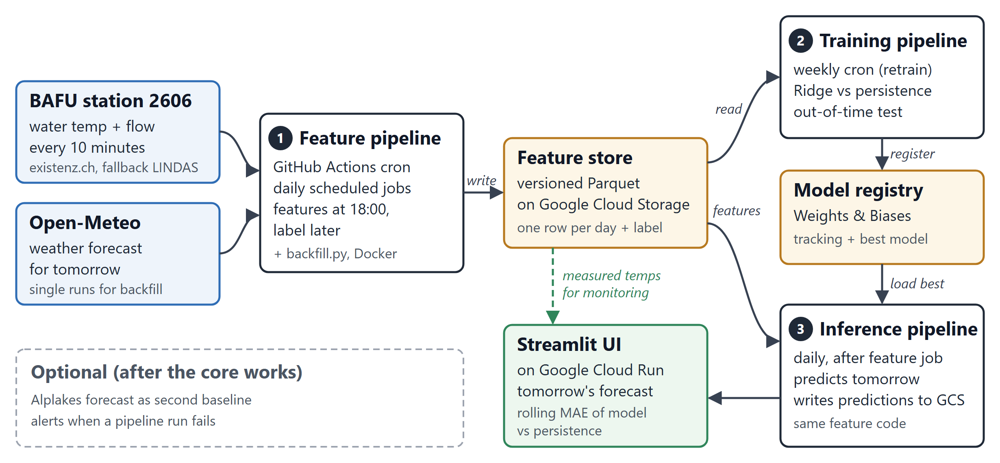

# Lake Geneva Temperature Forecast

Predicts tomorrow's mean water temperature of Lake Geneva at Geneva (BAFU station 2606, Rhône at Genève Halle de l'Île, where the lake drains). The forecast is made every evening with the data known at 18:00 and is compared with persistence ("tomorrow = the temperature now").

Built as the MLOps HS26 semester project (HSLU) with the Feature / Training / Inference (FTI) pipeline architecture.



*Architecture from the proposal. Changed in MS2: the live water data comes from the BAFU Data Platform (existenz.ch only as fallback, no LINDAS); the features use the 48-hour-old forecast, the Single Runs only for a comparison.*

## Status
- [x] MS1 – Proposal (`docs/proposal.pdf` is the repository version of 02.10.2026; the reviews used the version submitted on ILIAS)
- [ ] MS2 – Feature pipeline (summary and response to the MS1 reviews: `docs/ms2_summary.pdf`)
- [ ] MS3 – Training pipeline
- [ ] MS4 – Live system

## Goal and success criterion
At 18:00 on day D the model predicts the mean water temperature of D+1 (6 to 30 hours ahead). The model succeeds if its MAE is **at least 20 % lower than the MAE of the stronger baseline, on the same days**:
- **Main target:** the test days from 21.01.2025 on. For each test day the model is trained again on all days before it (walk-forward evaluation in MS3). The first year with all features (21.01.2024–20.01.2025, 366 days) is for validation: it is used to choose the model settings and never counts for the target.
- **Target on the big-change days:** the test days on which the temperature changes by more than 0.8 °C, where persistence fails.
- **Reported, not a target:** October–January (only 6 big-change test days, and there plain and trend-adjusted persistence are equally good) and the live period October 2026 – January 2027 (monitoring in MS4).

The stronger baseline is plain persistence, the last reading before 18:00. Trend-adjusted persistence (the last reading plus a third of the 3-day trend, suggested in the MS1 reviews) is worse:

| Test days (21.01.2025–25.10.2026, 18:00 cutoff) | Days | Persistence MAE | Trend-adjusted MAE | Target MAE (−20 %) |
|---|---|---|---|---|
| all test days | 643 | 0.532 °C | 0.722 °C | ≤ 0.425 °C |
| change > 0.8 °C | 100 | 1.921 °C | 2.095 °C | ≤ 1.537 °C |
| October–January (reported) | 159 | 0.276 °C | 0.279 °C | (0.221 °C) |

Numbers of 27.10.2026 (every new day adds one test day); `python src/lakegeneva/common/baselines.py` recomputes them with 95 % bootstrap intervals [8]. The criterion changed since the proposal; `docs/ms2_summary.pdf` explains why (MS1 review points A1, A2/B2, B3).

## Related work and what is different here
- **KTH ID2223 2025/26, "Water Temperature at Södertälje"** [10]: predicts the water temperature at bathing sites in Södertälje from municipality open data and Open-Meteo forecasts.
- **Another HS26 project** forecasts river water temperature with existenz.ch and Open-Meteo (named in the MS1 editorial summary).
- **Eawag's Alplakes** [11] publishes physics-based simulations of Lake Geneva; a comparison is an optional extra for MS4.

What is specific here: the outflow of a large lake. Its huge heat store makes persistence very strong, but strong south-west wind pushes the warm surface water away from Geneva and cold deep water comes up (upwelling): from 5 to 8 July 2025 the outflow cooled from 26.0 °C to 14.5 °C in three days, after south-west wind of 9-13 km/h. Hence ten years of official 10-minute data, a south-west wind feature from forecasts that existed before 18:00, and a success target on the big-change days.

## Data sources
- **Water:** FOEN/BAFU hydrology data (water temperature and flow, 10-min resolution) from the official [BAFU Data Platform](https://data.bafu.admin.ch), the same source as the training history (backfill: 10-min values and daily means back to 2016). Fallback when BAFU does not answer: the same readings via [api.existenz.ch](https://api.existenz.ch) (the main source until 27.10.2026).
- **Weather:** [Open-Meteo](https://open-meteo.com). The features use the Previous Runs API [6]: for every hour, the forecast made 48 hours earlier, which always existed before the 18:00 cutoff (complete from 20.01.2024). For a comparison in MS3, the daily job also saves the forecast of the ECMWF IFS run started at 06:00 UTC (Single Runs API [9]: published by about 12:00 UTC, so also before the cutoff; archived from 10.08.2024), and the newest forecast as an audit copy. All weather times are saved in UTC and converted to Swiss time with summer time in `features.py` (Open-Meteo's own "Europe/Zurich" uses one fixed offset for a whole download).

## The feature pipeline
Every evening (`.github/workflows/feature-pipeline.yml`, 19:00 UTC):
1. `dvc pull` gets the current data version from the bucket.
2. The download scripts add the newest water readings and forecasts to `data/raw/` (each one overlaps the last 7 days, so a missed day is filled in).
3. `build_features.py` rebuilds the whole daily feature table with the one shared feature definition in `src/lakegeneva/common/features.py` and saves it as `data/features/features.parquet`.
4. `dvc push` stores the data in the bucket, and the job commits the two pointer files: one data version per day.

The rules that prevent leakage: every day is a Swiss calendar day (with summer time); the water features use only readings before 18:00 Swiss time, the weather features only forecasts made 48 hours earlier; the label (tomorrow's mean) needs at least 120 of the 144 readings, and tomorrow must be over. All columns, units and gap rules: [`DATACARD.md`](DATACARD.md).

## Where the data lives
Data and models are never stored in Git; Git only holds code, configuration and small DVC pointer files. The only exception is a 4-day test sample of real BAFU readings in `tests/fixtures/` (22 KB), so that CI can test the feature code without the data.
- **Raw data and features (MS2):** versioned with DVC [5]. The files are in the private Google Cloud Storage bucket `gs://lake-geneva-temp-data` (folder `dvc/`); Git holds only the pointer files `data/raw.dvc` (all raw downloads) and `data/features.dvc` (the feature table `features.parquet`, built by `src/lakegeneva/features/build_features.py`). Data versions are Git tags: `data-v1` = the raw data until 27.10.2026 and the first feature table.
- **Get the data** (needs a key of the bucket's service account): see "How to run" below. Without a key, the tests still run on the sample in `tests/fixtures/`, and the Docker image still runs the whole pipeline on the last 7 days (see "How to run").
- **Daily update:** the feature pipeline commits the two pointer files as `github-actions[bot]` ("chore(data): daily update ..."). So every day is one data version in Git, and every model can name the data it was trained on.
- **Models:** MLflow tracking and model registry hosted on DagsHub (alias `champion` = model in production).

## How to run
Set up and test (Python 3.12 and the exact package versions from `uv.lock`; the tests need no data and no internet):
```bash
git clone https://github.com/mariamicioni/lake-geneva-temp.git
cd lake-geneva-temp
uv sync
uv run pytest
```
Get the data (needs a key of the bucket's service account; the key path stays in `.dvc/config.local`, which is not in Git):
```bash
uv tool install "dvc[gs]==3.67.1"
dvc remote modify --local storage credentialpath <path to the key>
dvc pull
```
The feature pipeline by hand, the same steps as the daily job:
```bash
uv run python src/lakegeneva/features/ingest_water.py           # water, last 7 days (BAFU, existenz.ch as fallback)
uv run python src/lakegeneva/features/ingest_weather_runs.py    # 48-hour-old forecasts, last 7 days + tomorrow
uv run python src/lakegeneva/features/ingest_weather_single.py  # forecasts of the 06 UTC model runs, last 7 days
uv run python src/lakegeneva/features/ingest_weather.py         # newest forecast (audit copy)
uv run python src/lakegeneva/features/build_features.py         # the feature table data/features/features.parquet
uv run python src/lakegeneva/common/baselines.py                # the two baselines at the 18:00 cutoff
```
All downloads and the table at once (this is what the Docker image starts): `uv run python src/lakegeneva/features/run_pipeline.py`

Backfill: the same scripts with a start date:
```bash
uv run python src/lakegeneva/features/ingest_water.py --start 2016-01-01
uv run python src/lakegeneva/features/ingest_weather_runs.py --start 2022-01-01
uv run python src/lakegeneva/features/ingest_weather_single.py --start 2024-08-10
uv run python src/lakegeneva/features/ingest_bafu.py --start 2016-01-01   # BAFU daily means (for context)
```
With Docker, no key and no data needed: the image runs the whole pipeline with the public APIs. It downloads the last 7 days and builds the table from them (about 10 seconds). The files stay in the container and are deleted with it, so this is a check that the pipeline works:
```bash
docker build -t lake-geneva-features .
docker run --rm lake-geneva-features
```
With Docker and the real data (after `dvc pull`): the raw data is mounted read-only and the full table is written to `out/`:
```bash
docker run --rm -v "$PWD/data/raw:/app/data/raw:ro" -v "$PWD/out:/app/data/features" lake-geneva-features python -m lakegeneva.features.build_features
```
On Linux the user in the container must be allowed to write to `out/`: run `mkdir -p out` first and add `--user "$(id -u):$(id -g)"` after `--rm`.

## Repository layout
```
src/lakegeneva/
  features/    feature pipeline (ingest, backfill, build the table)
  training/    training pipeline (read features, train, evaluate, register)
  inference/   inference pipeline (load model, predict, serve)
  common/      shared code: feature definition, baselines
tests/         unit tests (run in CI); fixtures/ holds the small test sample
data/          raw/ and features/ (not in Git: DVC pointer files raw.dvc, features.dvc)
.github/workflows/  ci.yml (tests + image), feature-pipeline.yml (daily)
config/        settings without secrets
notebooks/     exploration only
docs/          proposal and milestone summaries
Dockerfile     image of the feature pipeline
DATACARD.md    columns, units and gap rules of the data
```

## Where the code comes from
I build this project on what the MLOps HS26 course teaches. When a file follows a course exercise, its header names the source. This table grows with every milestone.

| File | Based on | What I changed |
|---|---|---|
| `.github/workflows/ci.yml` | Block 1 exercise, Part D and the image job of its solution [5] | No model training step yet; runs the unit tests, then builds the image without publishing it |
| `.github/workflows/feature-pipeline.yml` | Block 1 exercise, Parts A (DVC) and D (CI with uv) [5] | Runs on a schedule; pulls and pushes the data with DVC and commits the pointer files |
| `pyproject.toml`, `uv.lock` | uv dependency management [4] | Own package layout under `src/lakegeneva/` |
| `Dockerfile`, `.dockerignore` | Block 1 exercise, Part C (multi-stage image) [5]; `PYTHONUNBUFFERED=1` from the Block 3 exercise [12] | Python 3.12 like the rest of the project, uv pinned to 0.13.0, our package copied to `/app/src`; no model, no HEALTHCHECK/EXPOSE (the feature pipeline is a job, not a web service); the default command runs the downloads and the build, so it needs no key; the real data can be mounted at run time |
| `src/lakegeneva/features/ingest_bafu.py` | BAFU Data Platform API documentation [1] | Written for this project |
| `src/lakegeneva/features/ingest_water.py` | existenz.ch Hydrology API documentation [2], BAFU Data Platform API documentation [1] (fallback and backfill) | Written for this project |
| `src/lakegeneva/features/ingest_weather.py` | Open-Meteo Forecast API documentation [3] | Written for this project |
| `src/lakegeneva/features/ingest_weather_runs.py` | Open-Meteo Previous Runs API documentation [6] | Written for this project |
| `src/lakegeneva/features/ingest_weather_single.py` | Open-Meteo Single Runs API documentation [9] | Written for this project |
| `src/lakegeneva/common/features.py` | The features of my proposal (`docs/proposal.pdf`), pandas documentation [7] | Written for this project |
| `src/lakegeneva/features/build_features.py` | pandas documentation [7] (Parquet) | Written for this project |
| `src/lakegeneva/features/run_pipeline.py` | The steps of the daily job (`feature-pipeline.yml`); "no shell tricks" from the Block 3 exercise [12] | Written for this project |
| `.dvc/config`, `data/raw.dvc`, `data/features.dvc` | Block 1 exercise, Part A (version the data with DVC) [5] | Google Cloud Storage instead of the local S3 bucket; the key path only in `.dvc/config.local` (not in Git) |
| `src/lakegeneva/common/baselines.py` | Trend-adjusted persistence and bootstrap interval suggested in the MS1 reviews (A1, A2/B2); moving-block bootstrap [8] | Written for this project |
| `DATACARD.md` | Block 1 lecture: document column names, dtypes and missing-value handling in a DATACARD.md [4] | Written for this project |

**AI use:** Anthropic Claude helped me write and test the code and the documentation. 

## References
[1] FOEN/BAFU (2026). BAFU Data Platform, Hydrological Observations API (GraphQL). accessed on 11.10.2026 from data.bafu.admin.ch
[2] Existenz.ch (2026). Hydrology API (republished BAFU data). accessed on 01.10.2026 from api.existenz.ch
[3] Open-Meteo (2026). Weather Forecast API. accessed on 20.10.2026 from open-meteo.com/en/docs
[4] Bär, Florian (2026). Versioning and Containerization, MLOps HS26 Block 1, lecture slides. Lucerne University of Applied Sciences and Arts.
[5] Bär, Florian (2026). Course project, Block 1: version the data, track the model, ship the service (exercise_quotes_1_version_and_ship), Part A: DVC, Part C: Docker, Part D: CI. MLOps HS26, Lucerne University of Applied Sciences and Arts.
[6] Open-Meteo (2026). Previous Runs API. accessed on 27.10.2026 from open-meteo.com/en/docs/previous-runs-api
[7] pandas development team (2026). pandas documentation, version 3.1. accessed on 27.10.2026 from pandas.pydata.org/docs
[8] Künsch, Hans R. (1989). The Jackknife and the Bootstrap for General Stationary Observations. The Annals of Statistics 17(3), 1217-1241.
[9] Open-Meteo (2026). Single Runs API. accessed on 27.10.2026 from open-meteo.com/en/docs/single-runs-api
[10] KTH (2026). ID2223 project showcase 2025/26: Water Temperature at Södertälje. accessed on 27.10.2026 from id2223kth.github.io/assignments/2026/ID2223Projects2026.html
[11] Eawag (2026). Alplakes, lake simulations and forecasts. accessed on 27.10.2026 from alplakes.eawag.ch
[12] Bär, Florian (2026). Course project, Block 3: scrape the data (exercise_quotes_3_scrape), Dockerfile. MLOps HS26, Lucerne University of Applied Sciences and Arts.
